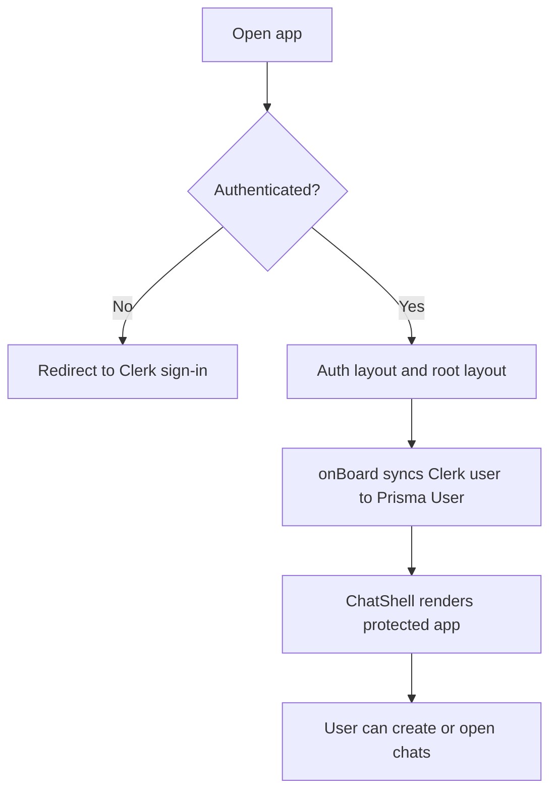
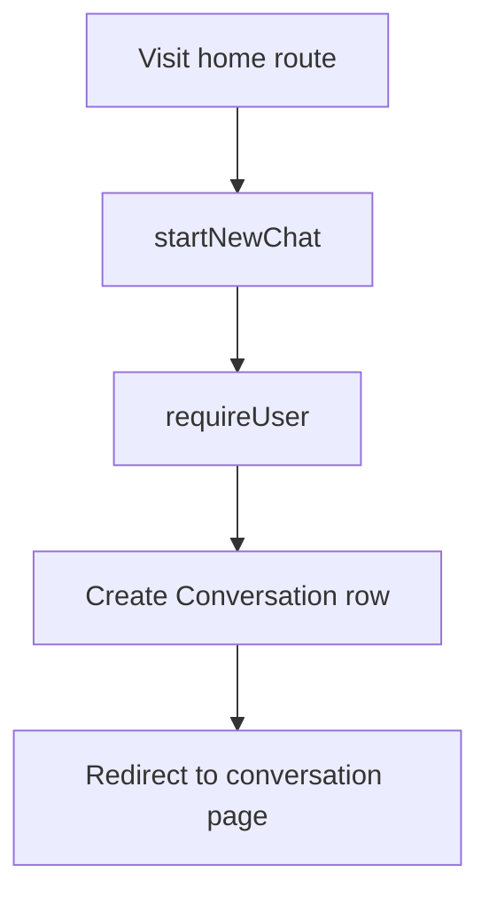
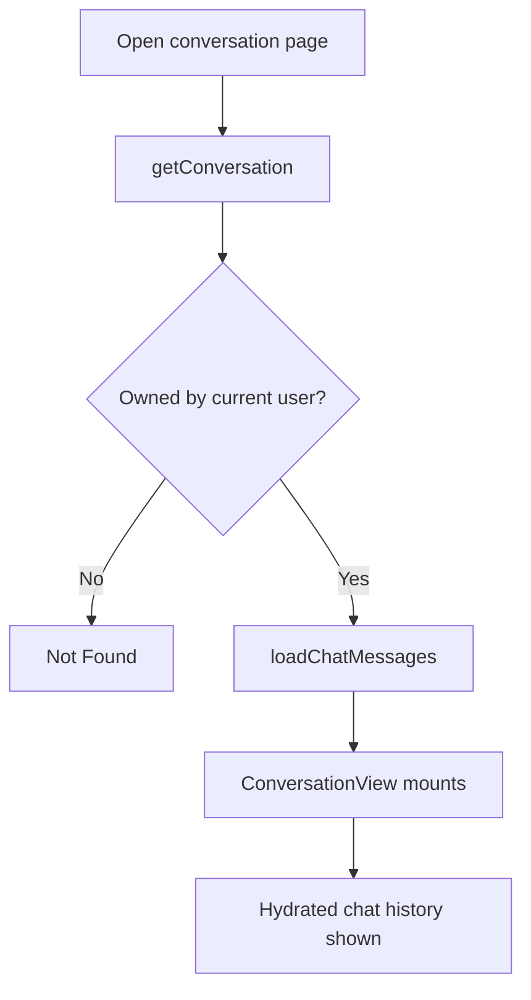
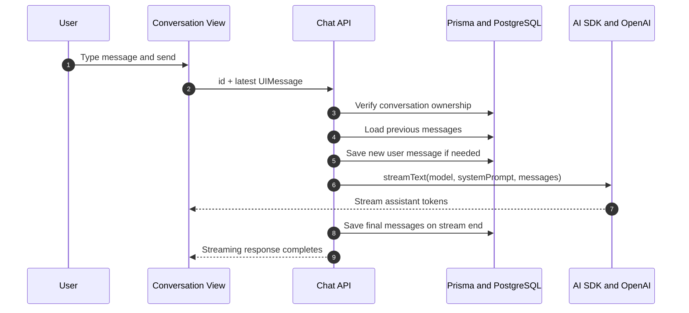
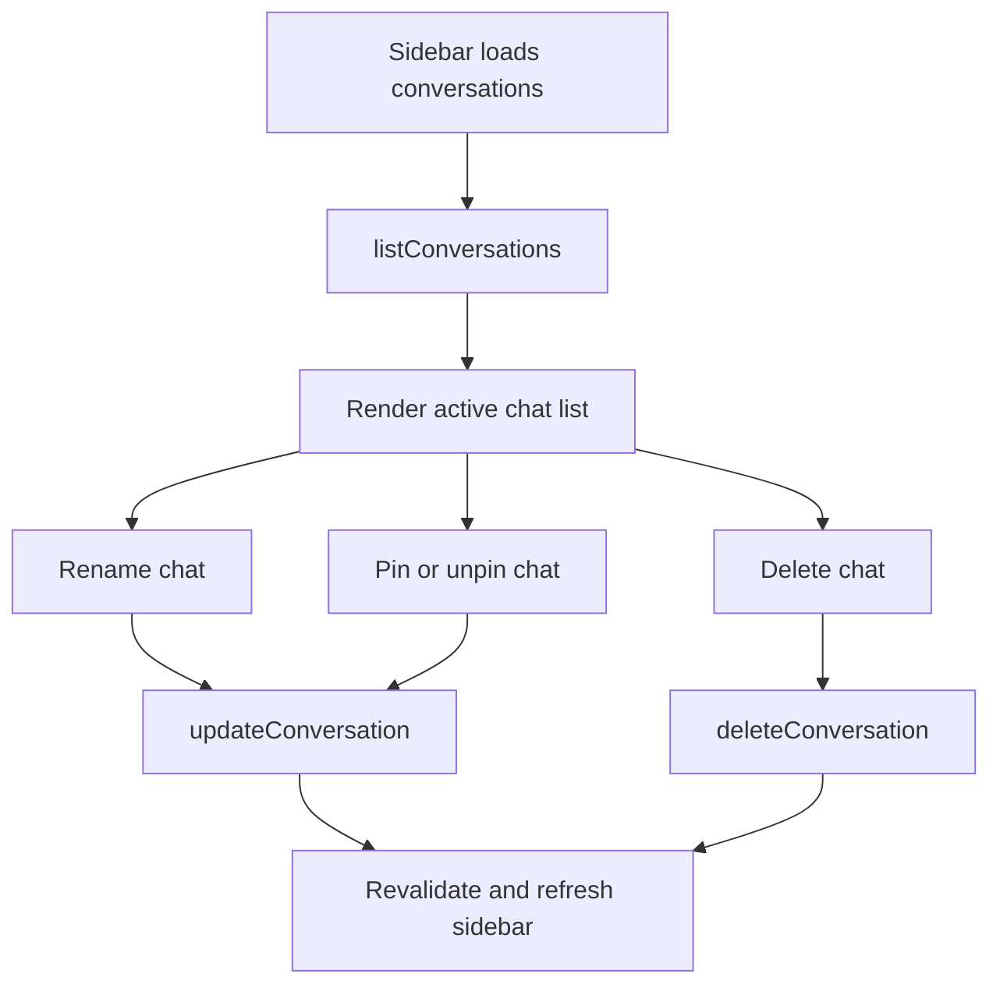
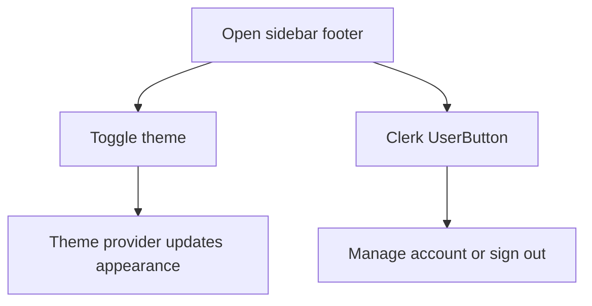

# ChaiGPT

ChaiGPT is a modern AI chat application built with Next.js, Clerk, Prisma, PostgreSQL, and the Vercel AI SDK. It provides authenticated chat sessions, streaming assistant responses, persistent conversation history, sidebar conversation management, and a clean chat UI.

## Overview

The app is organized around authenticated chat conversations:

- Users sign in through Clerk.
- Onboarding syncs the Clerk profile into the local `User` table.
- The home route creates a new conversation and redirects to `/c/[id]`.
- Messages stream through `/api/chat` and are persisted with Prisma.
- The sidebar lets users rename, pin, and delete chats.

## Tech Stack

- Next.js App Router
- React 19
- TypeScript
- Clerk authentication
- Prisma ORM
- PostgreSQL
- Vercel AI SDK
- TanStack Query
- Tailwind CSS 4
- shadcn/ui and Base UI primitives

## Project Flows

### 1) Authentication and onboarding flow

This flow protects the app, signs the user in with Clerk, and ensures the user exists in the local database before any chat action is allowed.



### 2) New chat creation flow

The root page creates a new conversation on load and redirects to the new conversation route.



### 3) Open conversation and load history flow

When a conversation route is opened, the app validates ownership and loads stored messages before the client chat view mounts.



### 4) Send message and stream assistant response flow

This is the main chat loop. The UI sends the latest message to the API, the backend streams the AI response, and the final message set is saved back to the database.



### 5) Sidebar conversation management flow

The sidebar lists the user’s non-archived chats and provides rename, pin, and delete actions.



### 6) Theme and account flow

The shell also exposes a theme toggle and Clerk account button in the sidebar footer.



## Flow Diagrams from Notes

The following reference diagrams are stored in the `Notes` folder and embedded here for quick access.

### AI Frontend Flow


### AI Backend Flow


## Setup Dependencies

### Prerequisites

- Node.js 20 or newer
- npm
- PostgreSQL database
- Clerk application keys
- OpenAI-compatible API key

### Install project dependencies

```bash
npm install
```

### Environment variables

Create a `.env.local` file and provide the values required by your deployment:

```bash
DATABASE_URL="postgresql://..."
CLERK_SECRET_KEY="..."
NEXT_PUBLIC_CLERK_PUBLISHABLE_KEY="..."
OPENAI_API_KEY="..."
```

### Prisma setup

```bash
npx prisma generate
npx prisma migrate dev
```

## Run the app

```bash
npm run dev
```

Open the app at `http://localhost:3000`.

## Available Scripts

- `npm run dev` starts the local development server.
- `npm run build` creates a production build.
- `npm run start` starts the production server.
- `npm run lint` runs ESLint.

## Key Features

- Clerk-authenticated access to the app.
- Automatic user onboarding into the database.
- New chat creation with redirect to a conversation route.
- Streaming assistant responses through the AI SDK.
- Persistent conversations and messages in PostgreSQL.
- Sidebar conversation management with rename, pin, and delete actions.
- Message history hydration when reopening a chat.
- Theme toggling and Clerk account controls in the shell.

## Data Model

The Prisma schema centers on three entities:

- `User` stores Clerk identity and profile data.
- `Conversation` stores chat metadata such as title, pin state, archive state, and model override.
- `Message` stores chat content, role, status, and structured AI parts.

## Repository Structure

- `app/` contains the Next.js routes and layouts.
- `features/auth/` contains Clerk onboarding and user validation.
- `features/conversation/` contains chat list, sidebar, and conversation view logic.
- `features/ai/` contains message persistence and model helpers.
- `components/` contains reusable UI and AI chat primitives.
- `prisma/` contains the schema and migrations.
- `Notes/` contains the frontend and backend flow reference images.

## Important Routes

- `/` creates a new conversation and redirects to it.
- `/c/[id]` renders a specific conversation.
- `/api/chat` streams AI responses for the active conversation.

## Notes

- Conversations are owned by the signed-in user and are validated on the server before reads or writes.
- The first user message can auto-title a chat when the conversation is still named `New Chat`.
- Message persistence is idempotent so duplicate UI messages are not stored twice.

## Deployment

### Deploy on Vercel

Vercel is the recommended deployment target for this project.

1. Push the repository to GitHub, GitLab, or Bitbucket.
2. Import the repository into Vercel and let it detect the Next.js app.
3. Add the required environment variables in the Vercel project settings:

```bash
DATABASE_URL
CLERK_SECRET_KEY
NEXT_PUBLIC_CLERK_PUBLISHABLE_KEY
OPENAI_API_KEY
```

4. Make sure your PostgreSQL database is reachable from Vercel.
5. Run Prisma migrations against the production database before or during release.
6. Deploy the project from Vercel.

### Prisma on production

After the app is deployed, run the Prisma commands against the production database:

```bash
npx prisma generate
npx prisma migrate deploy
```

### Recommended Vercel checks

- Verify Clerk redirect URLs point to your Vercel domain.
- Confirm the `NEXT_PUBLIC_CLERK_PUBLISHABLE_KEY` value is set for the production environment.
- Confirm `DATABASE_URL` uses the production database connection string.
- Test a sign-in, a new chat, and one streamed response after deployment.
